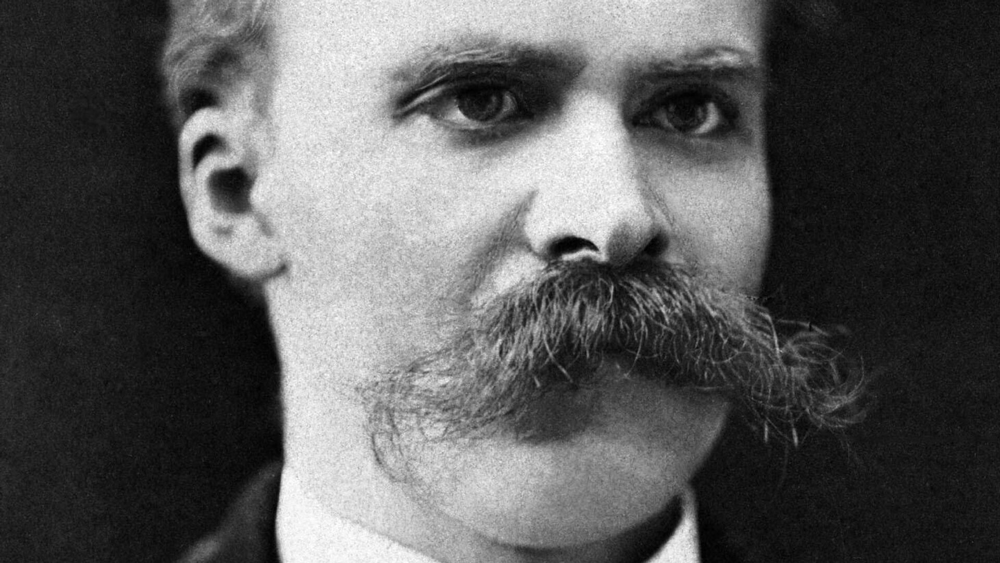

# Лабораторная работа № 1

## Информация обо мне

- Мизрин Павел Николаевич

- 6405-010302D

- Галанов Кирилл Валерьевич
- Тема диплома: нет

## Любимая цитата: 

> "Was fällt, das soll man auch noch stossen!"
> - Фридрих Ницше

## Картинка

 

# Лабораторная работа № 2

## Сайт о играх

- Я сделал небольшой сайт с информацией о популярных играх

- Создал 3 html файла и css файл, так же есть папка с картинками

# Лабораторная работа № 3

## Я установил Node.js

## Так же выполнил написание различных функций на языке JavaScript

